<div align="center">


# Podium

### Rehearse in a room that reacts.

A 3D rehearsal studio for public speaking. Step behind a real lectern, face 72 anime listeners who nod, drift and raise their hands, and leave every run with one clear thing to improve.

[](https://react.dev/)
[](https://www.typescriptlang.org/)
[](https://threejs.org/)
[](https://gsap.com/)
[](https://ai.google.dev/)
[](#-tested-end-to-end)
[](LICENSE)

**[Watch the walkthrough](docs/media/walkthrough.mp4)** · [Quick start](#-take-the-stage-in-60-seconds) · [Tour](#-the-tour) · [How it works](#-how-it-works) · [Privacy](#-your-voice-stays-yours)

<br/>

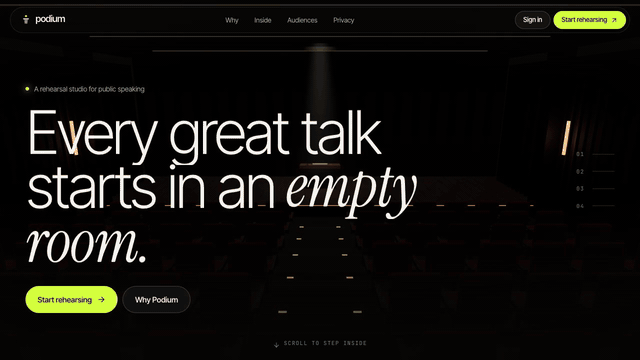

<sub>Scroll-driven flythrough on the landing page: the empty room fills row by row as you walk to the podium.</sub>

</div>

---

## 🎬 The tour

<table>
<tr>
<td width="50%">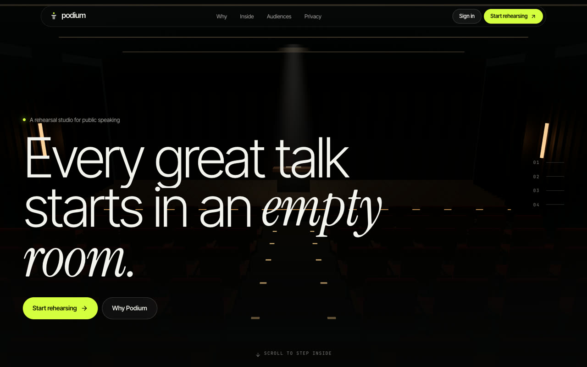</td>
<td width="50%">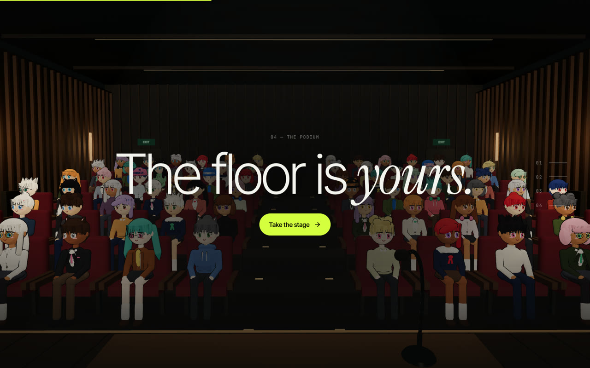</td>
</tr>
<tr>
<td><b>01 · The empty room.</b> A curtain parts on a dark, spotlit hall. Scrolling drives the camera with Lenis inertia and GSAP ScrollTrigger.</td>
<td><b>04 · The floor is yours.</b> The camera ends behind the lectern, looking out at a full house.</td>
</tr>
<tr>
<td>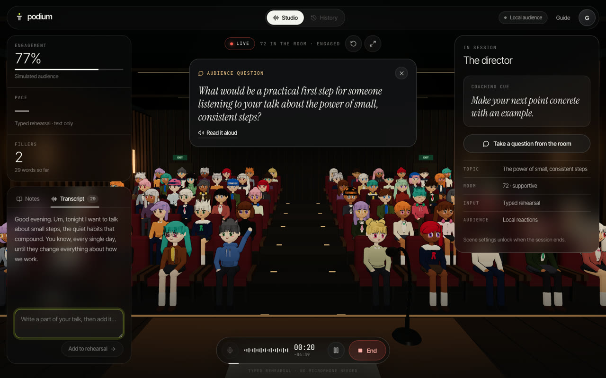</td>
<td>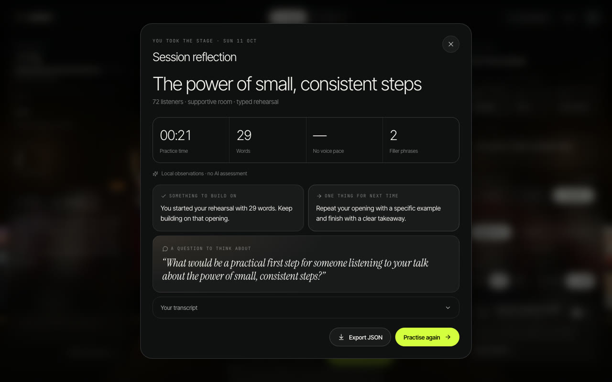</td>
</tr>
<tr>
<td><b>Live session.</b> Pace, fillers and engagement update as you speak. Someone in the front row raises a hand when the room has a question.</td>
<td><b>The reflection.</b> One strength, one change for next time, and a question to sharpen your thinking.</td>
</tr>
</table>

<div align="center">
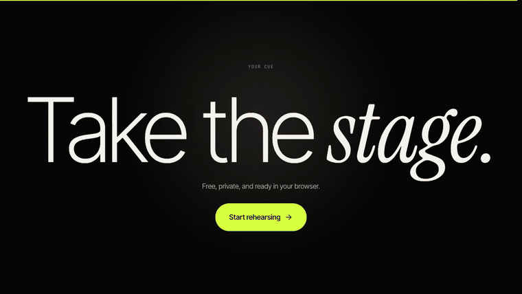
<br/><sub>A full rehearsal in ten seconds: speak (or type) → take a question → get your reflection.</sub>
</div>

<details>
<summary><b>📸 More screens: features, sign-in, history, focus mode, mobile</b></summary>
<br/>

| | |
|:--:|:--:|
| 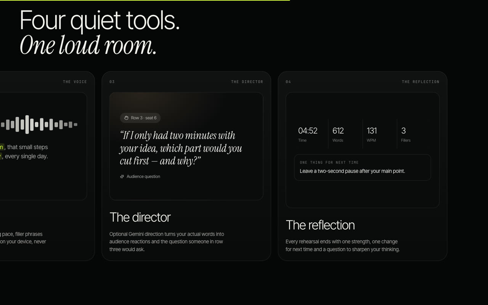 | 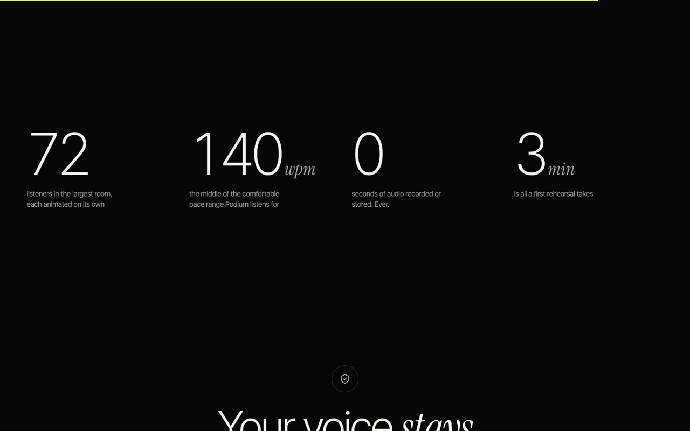 |
| Pinned horizontal feature track | Counters that animate in |
| 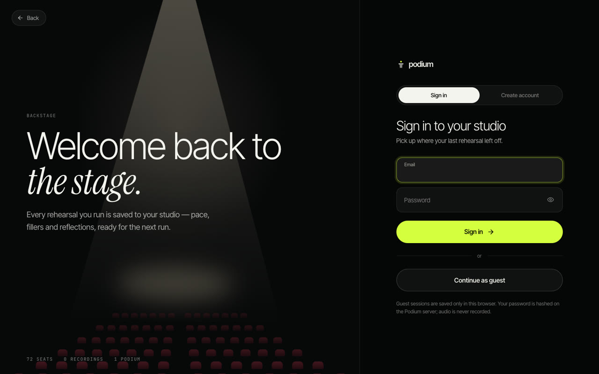 | 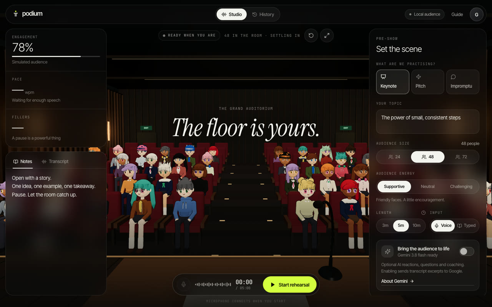 |
| Sign in, create an account, or continue as a guest | The studio, ready to set the scene |
| 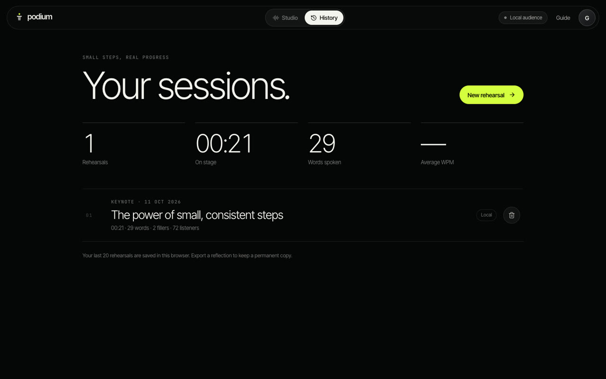 | 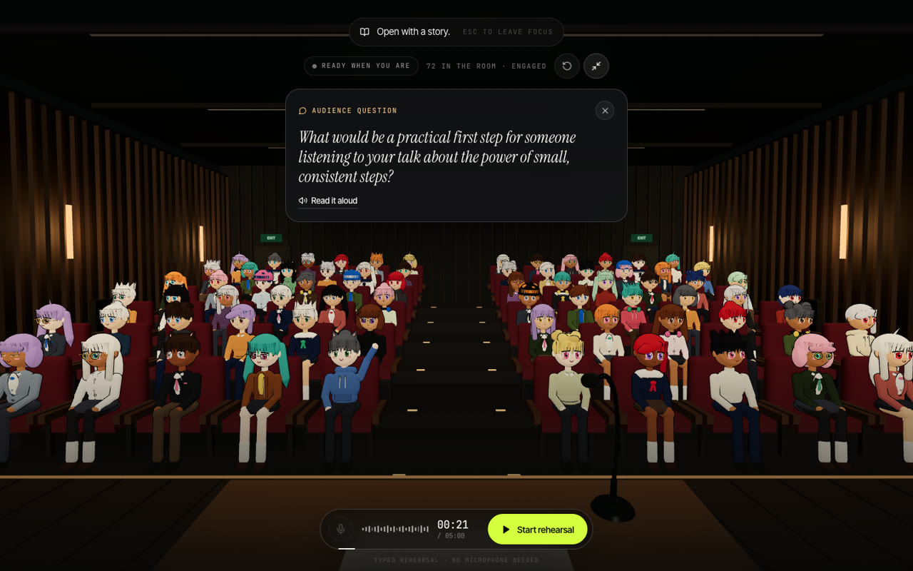 |
| Per-account session history | Focus mode: just you and the room |

<p align="center">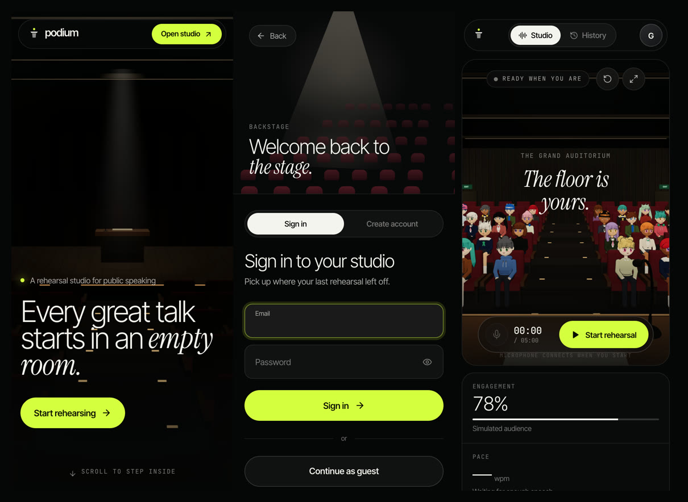<br/><sub>Every screen is designed for phones too.</sub></p>
</details>

---

## ⚡ Take the stage in 60 seconds

```bash
git clone https://github.com/satiricalguru/Podium.git
cd Podium
npm install
npm run dev
```

Open **http://127.0.0.1:5173**, scroll through the room, and hit **Start rehearsing**. Create an account, or **continue as a guest**: no keys, no setup and no recordings.

<details>
<summary><b>🔑 Optional: bring the audience to life with Gemini</b></summary>
<br/>

Podium is fully usable offline with its local audience engine. To get content-aware reactions, audience questions and coaching:

```bash
cp .env.example .env
```

```dotenv
# Server-side only. Never prefix with VITE_
GEMINI_API_KEY=your_google_ai_studio_key
GEMINI_MODEL=gemini-3.8-flash
# Optional: signs session cookies (otherwise generated into data/.session-secret)
SESSION_SECRET=
```

Restart `npm run dev`, then flip **Bring the audience to life** in *Set the scene*. Get a free key from [Google AI Studio](https://aistudio.google.com/). If the primary model is rate-limited or busy, Podium falls back to `gemini-2.5-flash`, then to local reactions.
</details>

<details>
<summary><b>🚀 Production build</b></summary>
<br/>

```bash
npm run build   # type-check + Vite build
npm start       # Express serves the API and the built app on PORT (default 3001)
```
</details>

---

## ✨ What's inside

<table>
<tr>
<td width="33%" valign="top">

### 🏛️ A room that feels real
- Theatre-lit procedural auditorium: velvet seats, walnut walls, a volumetric spotlight
- Speaker's-eye view from behind a lectern with a real gooseneck mic
- 24, 48 or 72 listeners
- Zero downloaded assets

</td>
<td width="33%" valign="top">

### 🎎 An audience with personality
- 72 cel-shaded anime characters with ink outlines
- 8 hair styles, 14 hair colours, 9 outfits, glasses, cat ears, headphones…
- **No two seats alike**, enforced by a unit test
- They blink, nod, glance away and raise hands

</td>
<td width="33%" valign="top">

### 🎙️ Feedback that helps
- Live transcription, speaking pace, filler phrases
- Supportive / neutral / challenging rooms
- Optional Gemini director for real questions
- A reflection after every run, exportable as JSON

</td>
</tr>
</table>

<details>
<summary><b>⌨️ Keyboard & accessibility</b></summary>
<br/>

| Action | How |
|:--|:--|
| Add typed text to the rehearsal | <kbd>⌘</kbd>/<kbd>Ctrl</kbd> + <kbd>Enter</kbd> |
| Leave focus mode / close any dialog | <kbd>Esc</kbd> |
| Move through dialogs | <kbd>Tab</kbd> (focus is trapped and restored on close) |

- Respects `prefers-reduced-motion`: no curtain, no smooth-scroll inertia, no camera parallax.
- Every control has an accessible name, and the mic level is exposed as a `meter`.
- Touch targets meet the WCAG 2.2 24px minimum.
</details>

---

## 🎭 How the audience thinks

The local engine is deterministic and transparent. Every number is labelled a *simulation*, never a judgment of you.

| | Supportive | Neutral | Challenging |
|:--|:--:|:--:|:--:|
| **Starting engagement** | `78%` | `65%` | `52%` |
| **Comfortable pace** | 105–175 WPM (`+8`) | 105–175 WPM (`+8`) | 105–175 WPM (`+8`) |
| **Outside that range** | `−8` | `−8` | `−8` |
| **Material bonus** | `+6` after 10 words, `+5` more after 40 | same | same |
| **Filler penalty** | after 20 words, up to `−15`, scaled by the share of words that are fillers | same | same |
| **Reactions** | > 72% engaged · > 54% curious · else distracted | same | same |

Engagement is clamped to 30–94%. Typed rehearsals never report a speaking pace, and voice pace needs at least 15 seconds and 5 words before it's shown.

---

## 🏗️ How it works

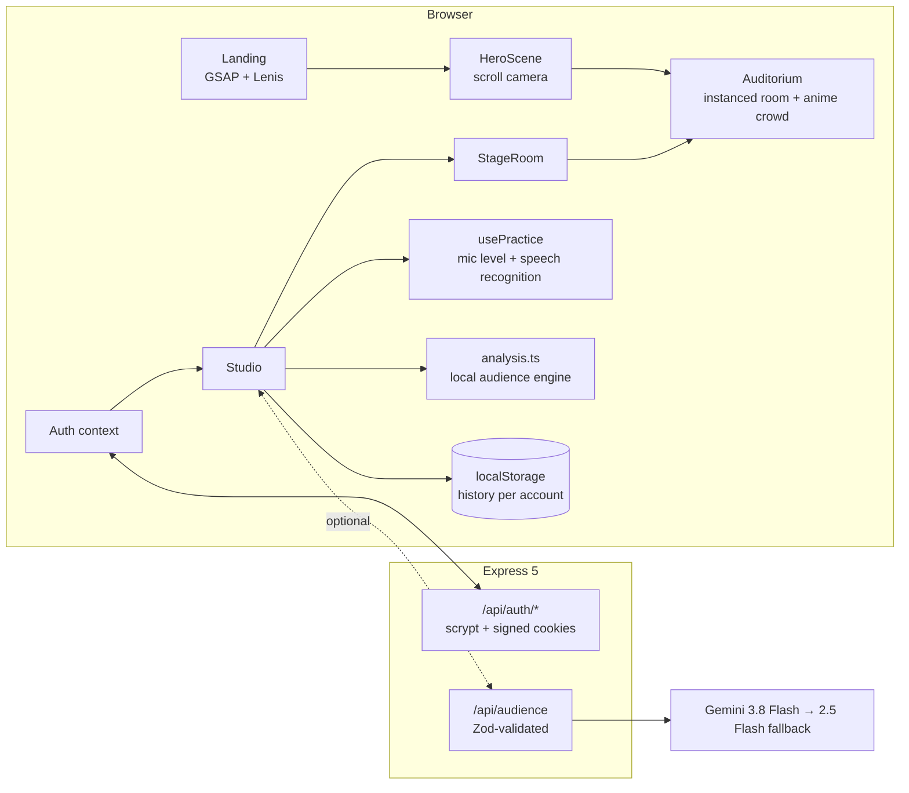

<details>
<summary><b>📂 Project structure</b></summary>

```text
server/
  auth.ts            password hashing, HMAC session tokens, JSON user store
  gemini.ts          model router with free-tier fallback
  index.ts           API, security headers, rate limits, origin checks
  validation.ts      Zod schemas for every request and response
src/
  landing/           Landing page, scroll-driven HeroScene, motion helpers
  auth/              AuthContext (account + guest) and the sign-in page
  studio/            Studio shell, panels, dialogs, history, StageRoom
  scene/
    Auditorium.tsx   theatre, lighting rig, gooseneck mic, listeners
    characters.ts    deterministic, unique anime character generator
    animeGeometry.ts cel-shaded geometry, toon ramp, ink outlines
  hooks/usePractice  Web Audio level meter + SpeechRecognition lifecycle
  lib/               analysis engine, storage, types
  styles/            "Limelight" design tokens + page styles
docs/media/          screenshots, GIFs and the walkthrough video
```
</details>

<details>
<summary><b>🎨 The "Limelight" design system</b></summary>
<br/>

A dark theatre where the rendered room carries the colour, the panels stay quiet, and **one limelight accent** marks the next action.

| Token | Value | Use |
|:--|:--|:--|
| `--void` | `#060607` | Canvas |
| `--ink` | `#f4f3ee` | Text |
| `--lime` | `#d4ff3f` | The single primary action per screen |
| Display | Inter Tight 240–300, −0.06em tracking | Headlines |
| Editorial | Instrument Serif italic | Emphasis |
| Labels | JetBrains Mono, uppercase, +0.12em | Micro-labels, timecodes |

All fonts are self-hosted: no requests to Google Fonts.
</details>

---

## 🧪 Tested end to end

```bash
npm test        # 21 unit tests: analysis, auth, validation, Gemini fallback, crowd uniqueness
npm run build   # strict TypeScript + production bundle
```

The final audit drove real Chrome through every route at desktop (1440×900) and mobile (390×844) sizes:

| Check | Result |
|:--|:--|
| Console errors / failed requests across all pages | **0** (excluding the deliberate wrong-password 401) |
| Horizontal overflow at any size | **None** |
| Unnamed controls / unlabelled fields | **None** |
| Sign-in validation · wrong password · route guard | ✅ · ✅ · `/history` → `/signin` |
| Full rehearsal: start → transcript → question + raised hand → end → reflection → history | ✅ |
| Focus mode + <kbd>Esc</kbd> · dialog focus trap | ✅ · ✅ |
| Studio frame rate with 72 animated listeners | **60 fps** |

---

## 🔒 Your voice stays yours

- **No recordings.** Podium measures levels and words in the moment and never stores audio. Browser speech recognition may process audio through your browser's own provider.
- **History stays on your device**, kept separately for each account. Export or delete it any time.
- **Accounts store only** your name, email and an scrypt password hash, in `data/users.json` on your server (git-ignored). Sessions are HttpOnly, HMAC-signed cookies.
- **AI only when you say so.** Gemini is off by default. When on, it receives transcript excerpts, never audio, and transcripts are treated strictly as untrusted data.
- **No pseudo-science.** No emotion, gaze, accent or confidence inference. Engagement is clearly labelled as simulated.

---

<div align="center">

**Made for the moments before the big moment.**

[MIT License](LICENSE) · Built with React, Three.js, GSAP and Lenis

</div>
